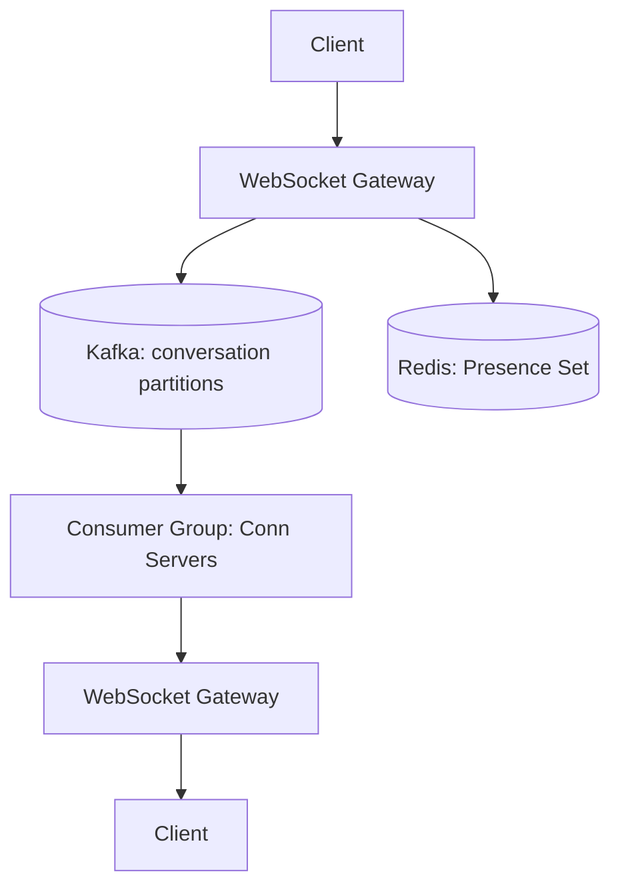
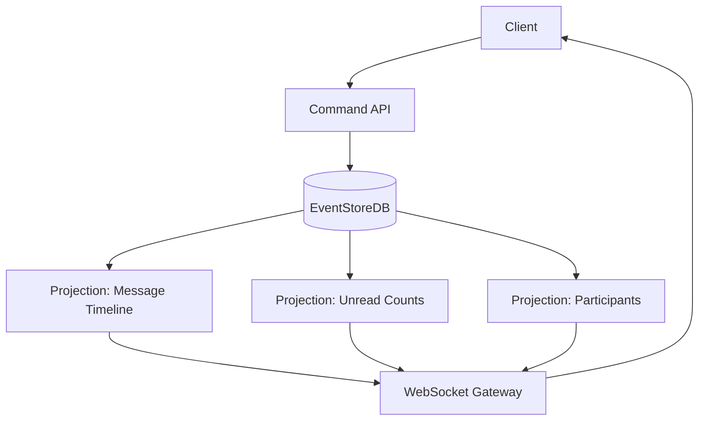
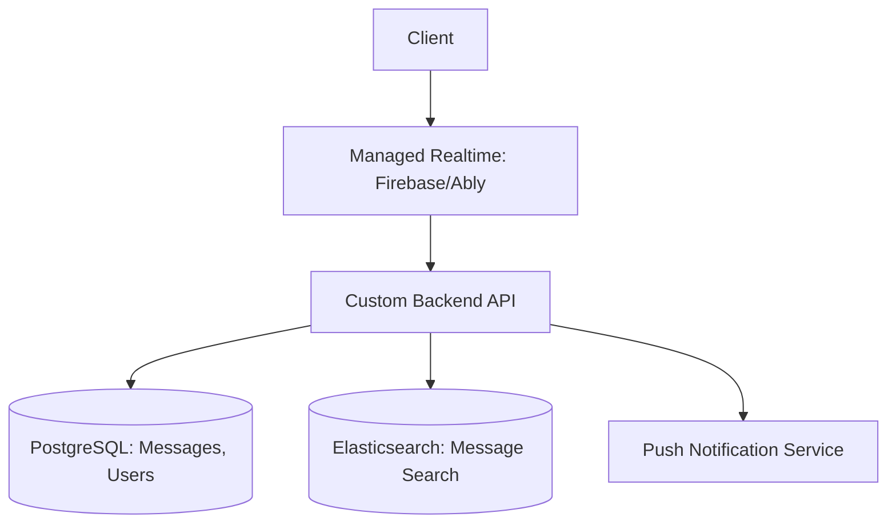

## Prompt

Design a real-time chat application supporting 1:1 messaging, group chats (up to 500 members), and channels (broadcast to unlimited subscribers). Features: message history, read receipts, typing indicators, online presence, push notifications for offline users.

## Constraints

- **Scale**: 50M daily active users; 1B messages/day
- **Latency**: Message delivery < 100ms (p99) for online users
- **Ordering**: Per-conversation causal ordering guaranteed
- **Availability**: 99.95% uptime; message durability 99.999%
- **Storage**: Message history retained for 1 year (hot), 7 years (cold)

## Solutions

### Solution 1: WebSocket + Pub/Sub with Per-Conversation Partitions

**Description**: Clients maintain persistent WebSocket connections to connection servers. Messages published to Kafka topics partitioned by conversation_id. Consumers (connection servers) subscribe to partitions for their connected users. Presence via heartbeat + Redis set.

#### Trade-offs

- **Decision**: Kafka partitioned by conversation_id for ordering.
  - **Advantage**: Strong per-conversation ordering; horizontal scale via partitions; replay for new consumers.
  - **Disadvantage**: Partition count limits parallelism; hot partitions for viral groups; operational complexity.

- **Decision**: WebSocket gateways as stateless connection servers.
  - **Advantage**: Easy horizontal scaling; connections survive gateway restarts via reconnection.
  - **Disadvantage**: Sticky sessions or routing layer needed; connection state in Redis.

- **Decision**: Redis for presence (heartbeat + sorted set).
  - **Advantage**: Fast online/offline checks; TTL auto-expiry for stale connections.
  - **Disadvantage**: Additional infrastructure; presence consistency vs. WebSocket state.

### Solution 2: Event Sourcing + CQRS with Materialized Views

**Description**: Model conversations as event-sourced aggregates. Commands (SendMessage, CreateGroup) produce events stored in EventStoreDB. Projections build read models: message timeline per conversation, unread counts, participant lists. WebSocket servers subscribe to projection updates via gRPC/WebSocket.

#### Trade-offs

- **Decision**: Event sourcing for chat domain.
  - **Advantage**: Complete audit trail; temporal queries; easy new projections; natural fit for messaging.
  - **Disadvantage**: Event schema evolution complexity; projection rebuild time; higher storage.

- **Decision**: CQRS separation.
  - **Advantage**: Read models optimized for query patterns; write path optimized for commands.
  - **Disadvantage**: Eventual consistency between write and read; dual model maintenance.

- **Decision**: Materialized views for message history.
  - **Advantage**: Fast pagination; no joins at read time; supports complex filters.
  - **Disadvantage**: Projection lag; storage amplification; rebuild on schema change.

### Solution 3: Hybrid — Managed Messaging (Firebase/Ably) + Custom Backend

**Description**: Use managed real-time infrastructure (Firebase Realtime Database, Ably, or Pusher) for message fan-out and presence. Custom backend handles authentication, authorization, message persistence, search, and business logic. WebSocket connections terminated by managed service.

#### Trade-offs

- **Decision**: Offload real-time fan-out to managed service.
  - **Advantage**: Massive scale handled by experts; built-in presence, offline sync, push; faster time-to-market.
  - **Disadvantage**: Vendor lock-in; cost at scale; limited customization; data residency concerns.

- **Decision**: Custom backend for persistence and business logic.
  - **Advantage**: Full control over data model, auth, search, compliance; portable.
  - **Disadvantage**: Dual write to managed service + DB; consistency challenges; more components.

## Related Problems

- [Design a Distributed Rate Limiter](./rate-limiter.md)
- [Design a Feed System](./feed-system.md)