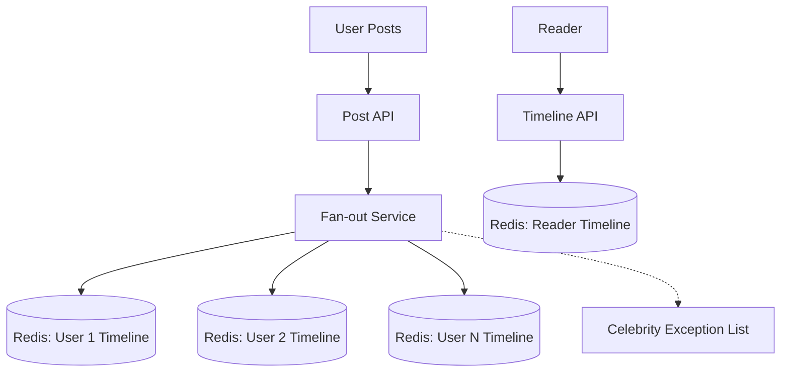
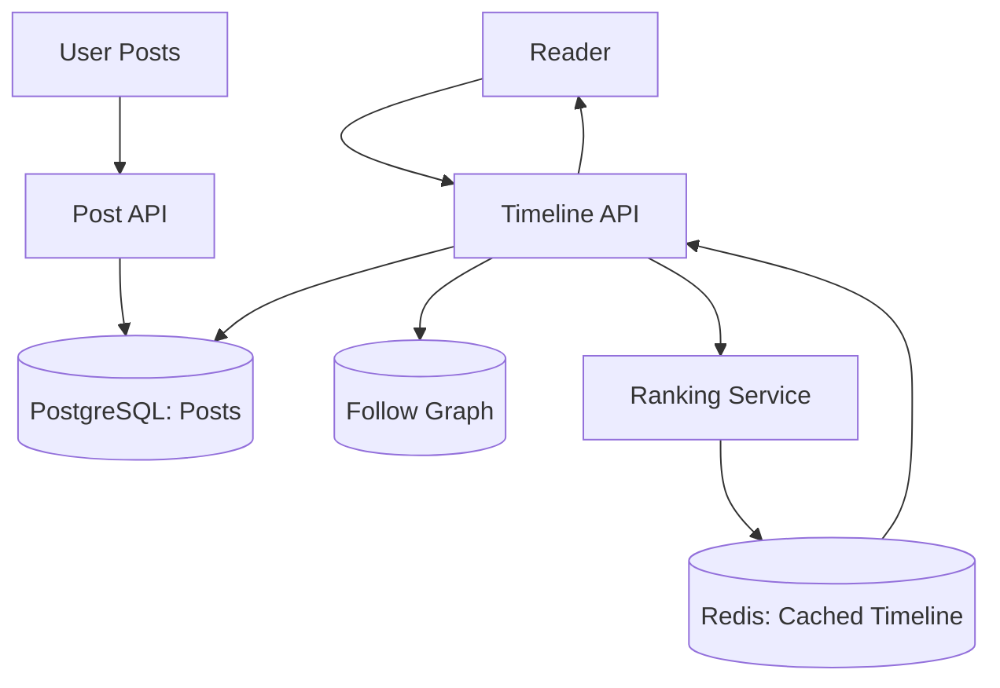
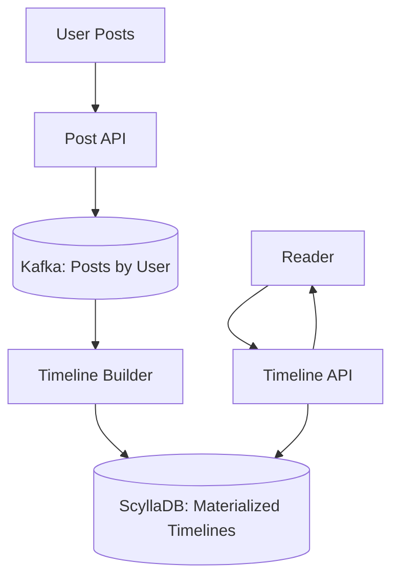

## Prompt

Design a social media feed system (like Twitter/Instagram timeline). Users follow other users. When a user posts, the post appears in followers' timelines. Support: chronological and algorithmic ranking, infinite scroll pagination, "while you were away" summaries, and real-time updates.

## Constraints

- **Scale**: 300M users; 100M posts/day; 1B timeline reads/day
- **Fan-out**: Average 500 followers; celebrities with 50M+ followers
- **Latency**: Timeline read < 50ms (p99); post visibility < 1s for followers
- **Availability**: 99.95% uptime
- **Storage**: Posts retained indefinitely; timeline generated on-demand or precomputed

## Solutions

### Solution 1: Fan-out on Write (Push Model)

**Description**: On post creation, push post ID to all followers' timeline Redis lists/sorted sets. Timeline read = fetch from user's precomputed timeline. Celebrities handled via "pull on read" hybrid: don't fan-out to massive follower counts; instead, merge celebrity posts at read time.

#### Trade-offs

- **Decision**: Fan-out on write for most users.
  - **Advantage**: Fast reads (O(1) list access); real-time updates natural; simple read path.
  - **Disadvantage**: Write amplification (500 writes per post); storage amplification; slow for high-fanout users.

- **Decision**: Hybrid pull for celebrities (>1M followers).
  - **Advantage**: Avoids massive write fan-out; reduces storage.
  - **Disadvantage**: Read path complexity (merge); slight staleness for celebrity posts.

- **Decision**: Redis sorted sets with score = timestamp.
  - **Advantage**: Natural ordering; easy pagination with ZRANGEBYSCORE; TTL for old entries.
  - **Disadvantage**: Memory cost; sorted set operations O(log N); cluster sharding by user_id.

### Solution 2: Fan-out on Read (Pull Model) with Ranking Service

**Description**: Posts stored in central PostgreSQL/PostgreSQL. On timeline read: fetch followee IDs, query posts from followees, merge and rank in ranking service, return paginated. Cache ranked timelines in Redis with short TTL. Real-time via WebSocket push of new post IDs.

#### Trade-offs

- **Decision**: Fan-out on read with ranking service.
  - **Advantage**: No write amplification; supports complex ranking; single source of truth.
  - **Disadvantage**: Read latency higher (multiple queries + ranking); cache invalidation complexity.

- **Decision**: Ranking service as separate microservice.
  - **Advantage**: ML models isolated; independent scaling; A/B testable.
  - **Disadvantage**: Additional network hop; service discovery; versioning.

- **Decision**: Short-TTL cached timelines.
  - **Advantage**: Absorbs read spikes; reduces DB load.
  - **Disadvantage**: Staleness; cache miss latency spike; memory for hot users.

### Solution 3: Event Sourcing + Materialized Timelines

**Description**: Posts as events in Kafka (partitioned by user_id). Consumer builds per-user materialized timeline in Cassandra/ScyllaDB (wide rows: user_id, timeline of post_ids). Timeline read = single row read. Ranking applied at materialization time. Real-time via WebSocket from consumer lag monitoring.

#### Trade-offs

- **Decision**: Event-sourced materialized timelines.
  - **Advantage**: Single-read timeline access; natural replay/rebuild; handles fan-out at write time in batch.
  - **Disadvantage**: Eventual consistency (consumer lag); rebuild cost; schema evolution.

- **Decision**: ScyllaDB/Cassandra wide rows.
  - **Advantage**: Linear scale; efficient time-series reads; TTL support.
  - **Disadvantage**: Operational complexity; no secondary indexes on clustering keys; tombstone issues.

- **Decision**: Ranking at materialization time.
  - **Advantage**: Read path stays simple; ranking logic centralized.
  - **Disadvantage**: Ranking changes require full rebuild; A/B testing harder.

## Related Problems

- [Design a Chat Application](./chat-application.md)
- [Design a Link Analytics Dashboard](./link-analytics.md)