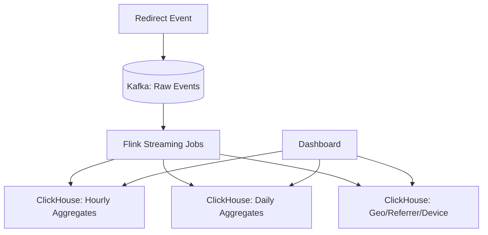
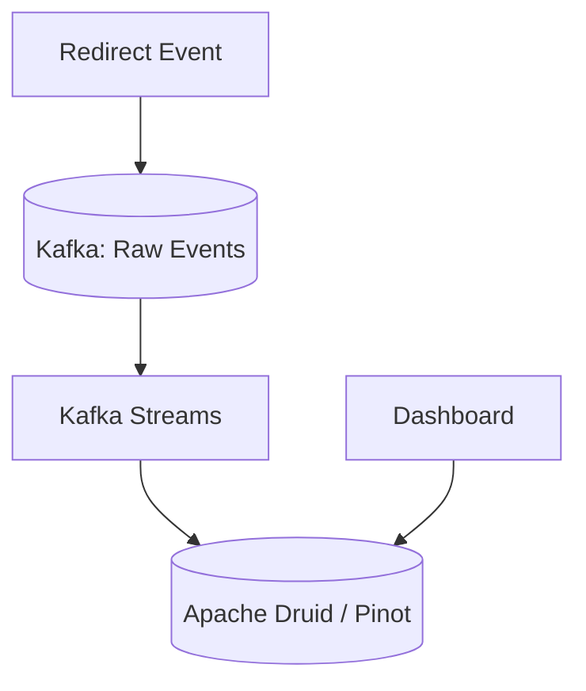
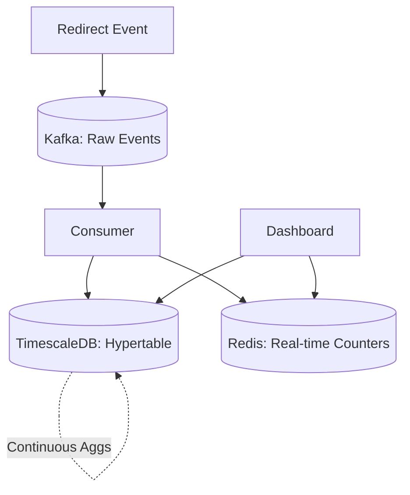

## Prompt

Design an analytics dashboard for a URL shortener service (like the one in "Design a URL Shortener"). Dashboard shows: real-time click rate, geographic heatmap, referrer breakdown, device/browser stats, time-series charts (hourly/daily), top links by clicks. Data must be queryable by link, user, and time range.

## Constraints

- **Scale**: 1B redirect events/day; 10M unique links; 100K dashboard users
- **Latency**: Dashboard queries < 500ms (p99); real-time updates < 5s delay
- **Retention**: Raw events 30 days (hot), 2 years (cold); aggregates indefinitely
- **Availability**: 99.9% for ingestion; 99.5% for dashboard queries
- **Cost**: Optimize for cost-effective storage and compute

## Solutions

### Solution 1: Kafka → Flink → ClickHouse (OLAP)

**Description**: Redirect events streamed to Kafka. Flink jobs process streams: tumbling windows for hourly/daily aggregates, session windows for user journeys. Results written to ClickHouse (MergeTree tables partitioned by date). Dashboard queries ClickHouse directly. Real-time via ClickHouse LIVE VIEW or materialized views with 1s refresh.

#### Trade-offs

- **Decision**: ClickHouse for OLAP.
  - **Advantage**: Columnar compression (10x); vectorized execution; fast aggregations; SQL interface.
  - **Disadvantage**: Not ideal for point lookups; mutations/updates expensive; operational expertise needed.

- **Decision**: Flink for stream processing.
  - **Advantage**: Exactly-once semantics; event-time processing; windowing; stateful; scalable.
  - **Disadvantage**: JVM-based; complex deployment; checkpointing overhead; learning curve.

- **Decision**: Pre-aggregated materialized views.
  - **Advantage**: Dashboard queries hit small aggregate tables; predictable latency.
  - **Disadvantage**: Limited ad-hoc flexibility; new dimensions require new views/rebuild.

### Solution 2: Kafka → Kafka Streams → Druid / Apache Pinot

**Description**: Events to Kafka. Kafka Streams for lightweight enrichment/aggregation (no separate cluster). Write to Apache Druid or Pinot for real-time OLAP. Both support streaming ingestion, rollup at ingestion, and sub-second queries. Dashboard queries Druid/Pinot via SQL/JSON API.

#### Trade-offs

- **Decision**: Kafka Streams over Flink.
  - **Advantage**: Embedded in app; no separate cluster; simpler ops; exactly-once with Kafka transactions.
  - **Disadvantage**: Less sophisticated windowing; state scaling limited to app instances; no savepoints.

- **Decision**: Druid/Pinot for real-time OLAP.
  - **Advantage**: Built-in real-time ingestion; rollup at ingest; tiered storage (hot/cold); sub-second latency.
  - **Disadvantage**: Segment-based architecture; complex tuning; SQL support varies; memory-heavy.

- **Decision**: Rollup at ingestion time.
  - **Advantage**: Drastically reduces storage; fast queries on pre-aggregated data.
  - **Disadvantage**: Loses raw event granularity; cannot answer new questions retroactively.

### Solution 3: Dual Write — PostgreSQL + TimescaleDB + Redis

**Description**: On redirect: write raw event to Kafka (durable log). Separate consumer writes to TimescaleDB (hypertable partitioned by time) for time-series queries. Counters in Redis for real-time rate (INCR with TTL). Dashboard: recent data from Redis/TimescaleDB; historical from TimescaleDB continuous aggregates.

#### Trade-offs

- **Decision**: TimescaleDB (PostgreSQL extension) for time-series.
  - **Advantage**: Full SQL; continuous aggregates auto-maintain; PostgreSQL ecosystem; hypertables transparent.
  - **Disadvantage**: Single-node write throughput limit; compression less aggressive than ClickHouse; scaling via read replicas only.

- **Decision**: Redis for real-time counters.
  - **Advantage**: Sub-millisecond INCR; natural TTL for sliding windows; simple.
  - **Disadvantage**: Memory-bound; not durable; separate query path.

- **Decision**: Dual write to Kafka + TimescaleDB.
  - **Advantage**: Kafka as source of truth; TimescaleDB for queries; decoupled.
  - **Disadvantage**: Two systems to operate; dual-write consistency; consumer lag monitoring.

## Related Problems

- [Design a URL Shortener](./url-shortener.md)
- [Design a Feed System](./feed-system.md)