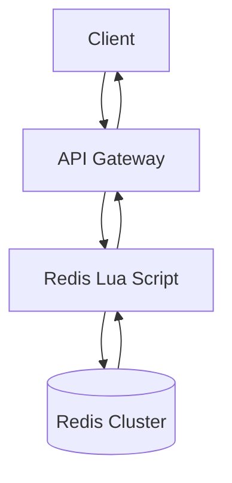
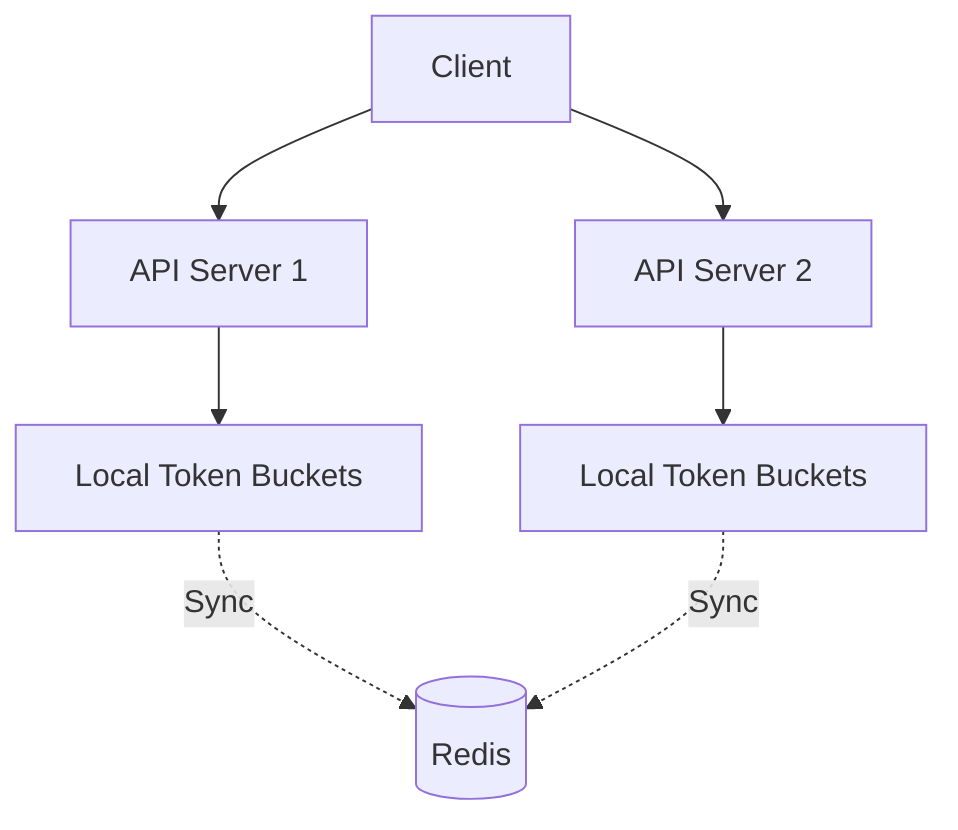
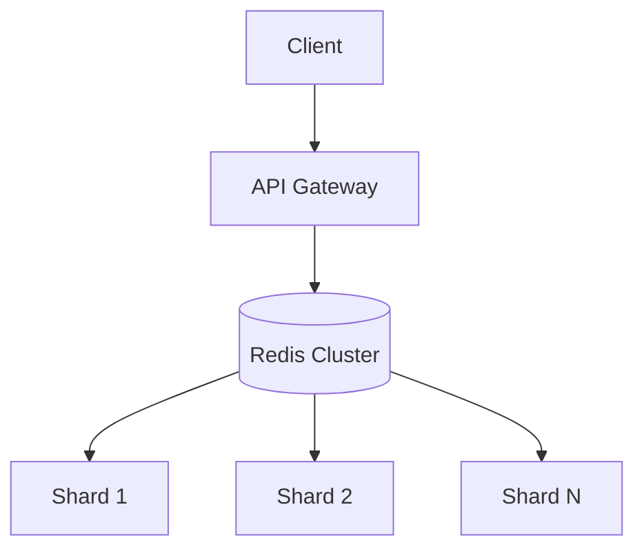

## Prompt

Design a distributed rate limiter that can enforce request quotas across a fleet of API servers. Clients are identified by API key or IP address. The limiter should support multiple algorithms (fixed window, sliding window, token bucket) and be configurable per client tier (free, pro, enterprise).

## Constraints

- **Scale**: 10M requests/second across all clients
- **Latency**: Rate limit check must add < 5ms (p99) to request path
- **Accuracy**: Sliding window accuracy within 1% of configured limit
- **Availability**: 99.99% uptime; limiter failure should fail-open (allow request)
- **Configuration**: Rate limits adjustable at runtime without deployment

## Solutions

### Solution 1: Redis Sliding Window Log with Lua Scripting

**Description**: Store request timestamps in a Redis sorted set per client key. Use a Lua script to atomically: remove expired entries, count current window, check limit, add current timestamp. Return allowed/denied + retry-after.

#### Trade-offs

- **Decision**: Sliding window log (exact) over fixed window.
  - **Advantage**: Precise rate limiting; no burst at window boundaries.
  - **Disadvantage**: Higher memory (stores all timestamps); O(log N) for sorted set operations.

- **Decision**: Lua script for atomicity.
  - **Advantage**: Single round-trip; no race conditions between check and increment.
  - **Disadvantage**: Script execution blocks Redis; complex scripts can cause latency spikes.

- **Decision**: Redis Cluster for horizontal scaling.
  - **Advantage**: Linear scale-out; automatic sharding by client key.
  - **Disadvantage**: Cross-slot operations not supported; cluster resharding complexity.

### Solution 2: Token Bucket with Local Caching + Periodic Sync

**Description**: Each API server maintains a local in-memory token bucket per client. Periodically (every 100ms) sync bucket state to Redis. On request: check local bucket first; if tokens available, consume and allow. If local empty, check Redis for refill. Fail-open if Redis unavailable.

#### Trade-offs

- **Decision**: Local token buckets with async sync.
  - **Advantage**: Ultra-low latency (in-memory); survives Redis blips; reduces Redis load.
  - **Disadvantage**: Over-limiting or under-limiting possible during sync interval; state divergence.

- **Decision**: Fail-open on Redis failure.
  - **Advantage**: Availability preserved; no single point of failure.
  - **Disadvantage**: Potential abuse during outage; requires monitoring/alerting.

- **Decision**: Token bucket algorithm.
  - **Advantage**: Smooths burst traffic; natural fit for "refill over time" semantics.
  - **Disadvantage**: More complex than fixed window; requires clock synchronization.

### Solution 3: Fixed Window with Counter Sharding

**Description**: Divide time into fixed windows (e.g., 1 second). For each client, maintain N counter shards in Redis (e.g., 10 shards). On request: increment random shard, sum all shards for current window. Reset shards on window boundary. Simpler than sliding log, lower memory.

#### Trade-offs

- **Decision**: Fixed window with sharded counters.
  - **Advantage**: Low memory (fixed counters); simple implementation; fast INCR operations.
  - **Disadvantage**: Allows 2x burst at window boundaries; less accurate.

- **Decision**: Counter sharding to reduce hot keys.
  - **Advantage**: Distributes load across Redis slots; avoids single-key contention.
  - **Disadvantage**: Requires summing N keys per check; slight over/under-count at boundaries.

## Related Problems

- [Design a URL Shortener](./url-shortener.md)
- [Design a Chat Application](./chat-application.md)