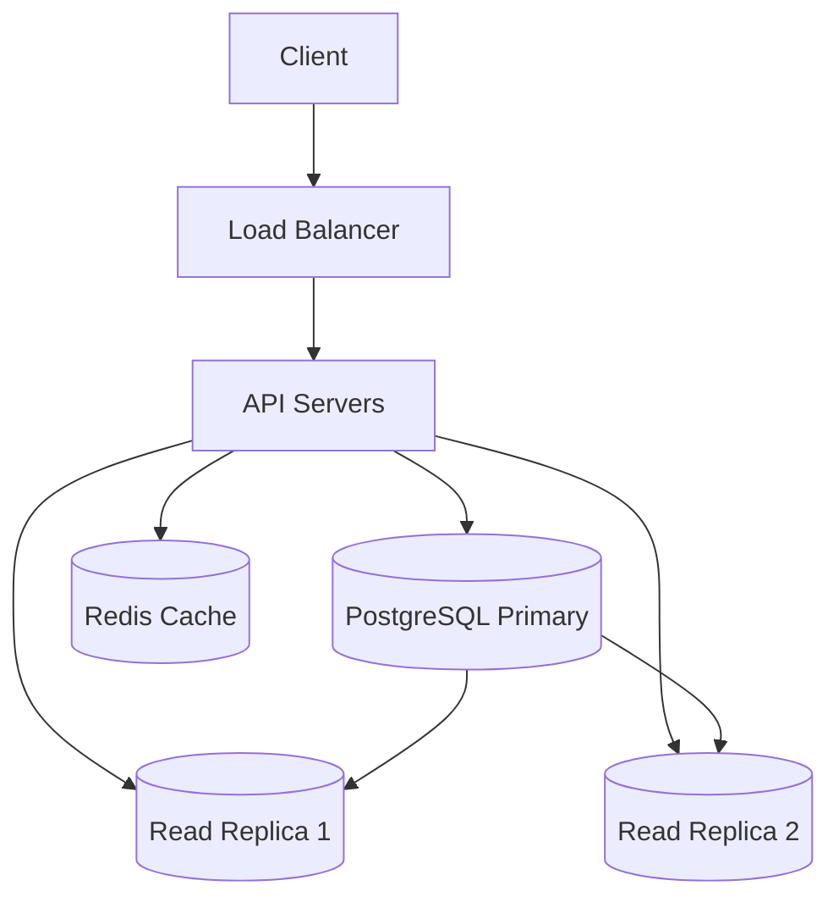
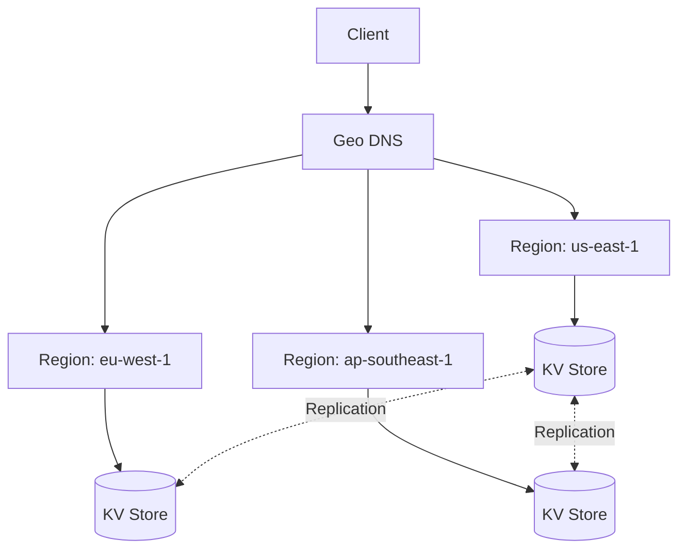
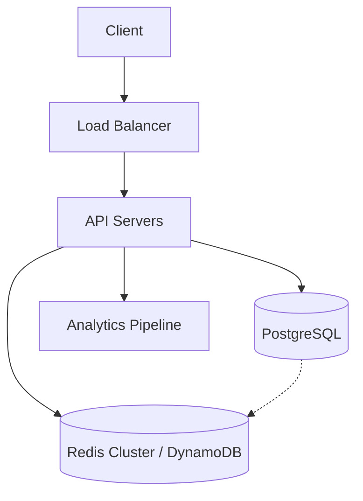

## Prompt

Design a URL shortening service like bit.ly or TinyURL. Users submit a long URL and receive a short, unique alias (e.g., `bit.ly/abc123`). When anyone visits the short URL, they are redirected to the original long URL.

## Constraints

- **Scale**: 100M URLs created per day, 1B redirects per day
- **Latency**: Redirects must complete in < 50ms (p99)
- **Availability**: 99.99% uptime
- **Storage**: URLs must be stored durably for at least 10 years
- **Custom aliases**: Users may optionally provide their own short code
- **Analytics**: Track click counts, referrers, and geographic data (async, eventually consistent)

## Solutions

### Solution 1: Single-Region SQL with Read Replicas

**Description**: Use a single PostgreSQL primary with multiple read replicas for redirect lookups. Write to primary for URL creation; read from replicas for redirects. Cache hot URLs in Redis.

#### Trade-offs

- **Decision**: Use a single PostgreSQL primary for all writes.
  - **Advantage**: Strong consistency for URL creation; simple operational model.
  - **Disadvantage**: Write throughput limited to single primary; single region adds latency for global users.

- **Decision**: Cache hot URLs in Redis with TTL.
  - **Advantage**: Sub-millisecond redirect latency for popular URLs; reduces DB load.
  - **Disadvantage**: Cache invalidation complexity; memory cost for hot set.

- **Decision**: Use read replicas for redirect queries.
  - **Advantage**: Scales read throughput horizontally; isolates write latency.
  - **Disadvantage**: Replication lag may serve stale data; additional infrastructure.

### Solution 2: Multi-Region Key-Value Store with Consistent Hashing

**Description**: Deploy a globally distributed key-value store (e.g., DynamoDB Global Tables, Cassandra, or FoundationDB) with consistent hashing for URL-to-target mapping. Each region serves reads and writes locally; conflicts resolved via last-writer-wins on URL creation (idempotent).

#### Trade-offs

- **Decision**: Multi-region active-active key-value store.
  - **Advantage**: Low latency globally; high write availability; linear scale-out.
  - **Disadvantage**: Eventual consistency; conflict resolution needed for custom aliases; higher operational complexity.

- **Decision**: Consistent hashing for partition assignment.
  - **Advantage**: Minimal data movement on scaling; uniform load distribution.
  - **Disadvantage**: Hot partitions possible for viral URLs; requires virtual nodes.

- **Decision**: Last-writer-wins for custom alias conflicts.
  - **Advantage**: Simple, no coordination needed.
  - **Disadvantage**: User may lose custom alias race; requires idempotent create API.

### Solution 3: Hybrid — SQL for Metadata, KV for Redirects

**Description**: Store URL metadata (creator, timestamps, analytics config) in PostgreSQL. Store the short-code → long-URL mapping in a high-throughput KV store (Redis Cluster or DynamoDB). Redirects hit KV store only; metadata queries hit SQL.

#### Trade-offs

- **Decision**: Separate storage for metadata vs. redirect mapping.
  - **Advantage**: Each store optimized for its access pattern; KV store scales redirects independently.
  - **Disadvantage**: Dual-write consistency; more complex backup/recovery.

- **Decision**: Asynchronous analytics pipeline.
  - **Advantage**: Redirect path stays fast; analytics processed in batch/stream.
  - **Disadvantage**: Analytics not real-time; requires idempotent event processing.

## Related Problems

- [Design a Distributed Rate Limiter](./rate-limiter.md)
- [Design a Link Analytics Dashboard](./link-analytics.md)